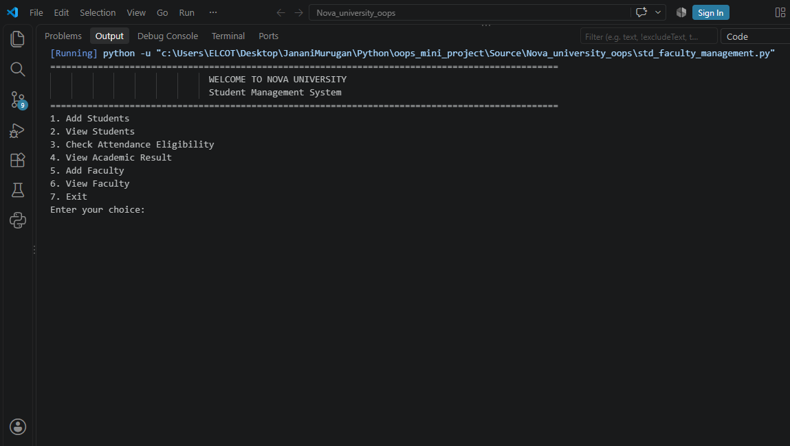
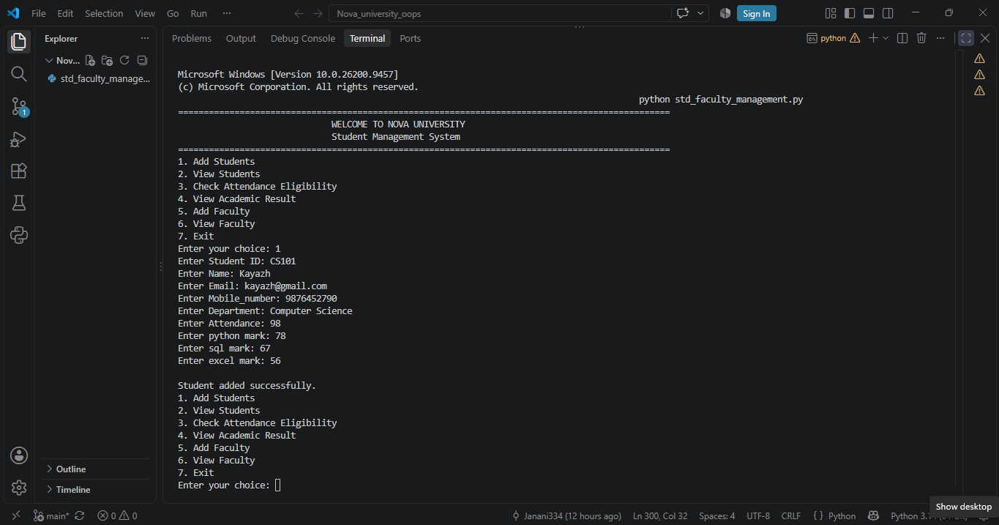
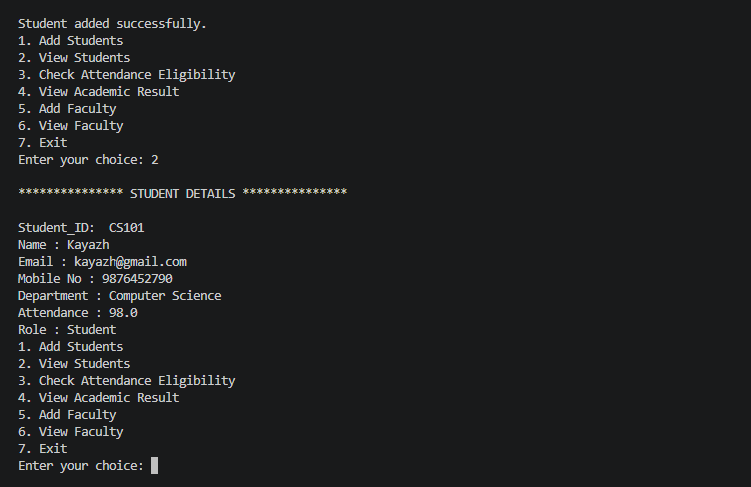
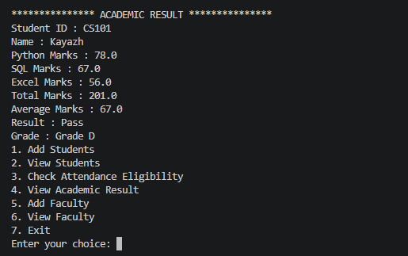
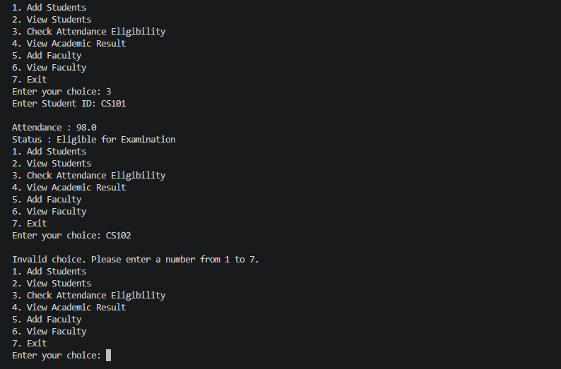
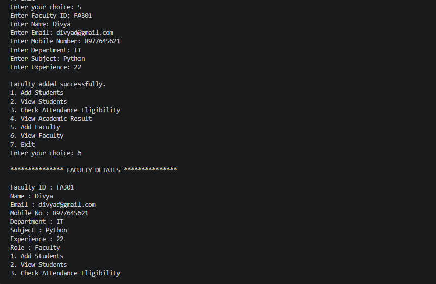

# Nova University Student Management System

## 1. Project Overview

The Nova University Student Management System is a Python-based console application developed using Object-Oriented Programming (OOP) principles. It manages student and faculty information and supports basic academic calculations, examination eligibility checks, and result evaluation.

The application provides a menu-driven interface that allows users to add and view student records, check attendance eligibility, calculate academic results, and maintain faculty details. It demonstrates the practical application of Python classes, objects, inheritance, polymorphism, methods, and input validation.

---

## 2. Business Problem

Educational institutions need an organized way to maintain student and faculty information and perform routine academic checks.

Manually handling student details, attendance eligibility, marks, grades, and faculty information can lead to repetitive work and inconsistent calculations.

This application addresses these basic requirements by providing a centralized, menu-driven program that organizes records in memory and applies reusable academic rules.

---

## 3. Project Objectives

- Maintain student and faculty information using Python classes.
- Apply inheritance to reuse common person-related attributes.
- Calculate total marks, average marks, results, and grades.
- Determine examination eligibility based on attendance.
- Validate attendance and academic marks within the accepted range.
- Support multiple student and faculty records during execution.
- Handle invalid student input without unnecessarily terminating the application.
- Demonstrate readable and reusable object-oriented programming practices.

---

## 4. Technologies Used

- **Programming Language:** Python
- **Programming Concepts:** Object-Oriented Programming (OOP)
- **Core Concepts:** Classes, objects, inheritance, polymorphism, methods, lists, conditional statements, loops, and exception handling
- **Application Type:** Menu-driven console application
- **Data Storage:** In-memory Python lists

No external libraries or database systems are required for the current implementation.

---

## 5. Key Features

### 5.1 Student Management

The application allows users to add and view student records.

Each student record contains:

- Student ID
- Name
- Email address
- Mobile number
- Department
- Attendance percentage
- Python marks
- SQL marks
- Excel marks

Multiple student objects can be maintained in the application during the current execution.

### 5.2 Faculty Management

The application supports adding and viewing faculty records.

Each faculty record contains:

- Faculty ID
- Name
- Email address
- Mobile number
- Department
- Subject
- Professional experience

Faculty details are organized using a dedicated class that inherits common person information.

### 5.3 Attendance Eligibility

The application evaluates examination eligibility based on the student's attendance percentage.

| Attendance | Eligibility |
|---|---|
| 75% or above | Eligible for Examination |
| Below 75% | Not Eligible |
| Below 0% or above 100% | Invalid input |

The attendance validation method accepts values from 0 to 100, inclusive.

### 5.4 Academic Result Calculation

The application calculates academic performance using marks in three subjects: Python, SQL, and Excel.

**Total Marks**
Total Marks = Python Marks + SQL Marks + Excel Marks

**Average Marks**
Average Marks = Total Marks / 3

**Pass Criteria**

A student passes when the average mark is greater than or equal to 50. Otherwise, the result is Fail.

### 5.5 Grade Classification

The application assigns grades according to the following average-mark ranges.

| Average Marks | Grade |
|---|---|
| 90–100 | Grade A |
| 80–less than 90 | Grade B |
| 70–less than 80 | Grade C |
| 60–less than 70 | Grade D |
| 50–less than 60 | Grade E |
| Below 50 | Grade F |

The grade is determined from the calculated average, not from an individual subject mark.

### 5.6 Input Validation

The application validates attendance and subject marks before accepting a student record.

- Attendance must be between 0 and 100.
- Python marks must be between 0 and 100.
- SQL marks must be between 0 and 100.
- Excel marks must be between 0 and 100.
- Invalid numeric input or values outside these ranges are handled through `ValueError` exception handling in the student-entry workflow.
- The current implementation does not apply equivalent range validation to faculty information.

---

## 6. Object-Oriented Design

The application uses three main classes to represent people, students, and faculty members.

### 6.1 `person` Class

The `person` class acts as the parent class and stores common attributes shared by students and faculty members.

**Attributes:**

- `name`
- `email`
- `mob_no`

**Method:**

- `display_role()` — returns the default role, `University Person`.

### 6.2 `student` Class

The `student` class inherits from `person` and adds student-specific information and academic behaviour.

**Key attributes:**

- `std_id`
- `dept`
- `att`
- `python_marks`
- `sql_marks`
- `excel_marks`

**Key methods:**

- `display_role()` — identifies the role as Student.
- `total()` — calculates total marks.
- `average()` — calculates average marks.
- `status()` — determines Pass or Fail.
- `grade()` — assigns the academic grade.
- `att_eligibilty()` — checks examination eligibility.
- `validate_att()` — validates attendance.
- `validate_marks()` — validates subject marks.

The class uses `super().__init__()` to initialize the common attributes inherited from the parent class.

### 6.3 `faculty` Class

The `faculty` class inherits from `person` and represents faculty-specific information.

**Additional attributes:**

- `faculty_id`
- `dept`
- `subject`
- `experience`

**Method:**

- `display_role()` — identifies the role as Faculty.

### 6.4 OOP Concepts Applied

- **Inheritance:** The `student` and `faculty` classes inherit common attributes from the `person` class, reducing the need to repeat shared information.
- **Polymorphism:** Both `student` and `faculty` override the `display_role()` method to return different role descriptions.
- **Encapsulation:** Related attributes and behaviours are grouped within their respective classes, keeping `person`, `student`, and `faculty` responsibilities organized.
- **Abstraction:** The application provides methods such as `total()`, `average()`, `status()`, and `grade()` so that academic calculations can be performed without repeating their internal logic in the menu workflow. This is method-based simplification rather than a formal abstract-class implementation.

---

## 7. Application Workflow

The program begins by displaying a welcome message for Nova University and presenting a menu.

The user can choose from the following options:

1. Add Students
2. View Students
3. Check Attendance Eligibility
4. View Academic Result
5. Add Faculty
6. View Faculty
7. Exit

**Workflow:**

1. The user selects an operation from the menu.
2. For student or faculty entry, the program collects the relevant information.
3. The application creates an object of the appropriate class.
4. Student records are validated and added to the student list when valid.
5. The user can view stored records or search for a student by Student ID to check attendance eligibility or academic results.
6. The application calculates academic values using the methods defined in the `student` class.
7. The menu continues until the user selects Exit.

If a requested student or faculty collection is empty, the application displays an appropriate message instead of attempting to display nonexistent records.

---

## 8. Screenshots

Add screenshots of the actual program output in the `screenshots` folder of the repository. Replace the example filenames below with the exact image filenames you commit.

### Main Menu

### Student Details

### Academic Result

### View Academic details

### Attendance Eligibility

### Faculty Details

---

## 9. Testing and Validation

The following cases can be used to verify the application's business rules.

| Test Case | Input | Expected Behaviour |
|---|---|---|
| Valid attendance | 75 | Accepted; eligible for examination |
| Minimum attendance | 0 | Accepted; not eligible |
| Maximum attendance | 100 | Accepted; eligible |
| Negative attendance | -5 | Rejected |
| Attendance above limit | 105 | Rejected |
| Valid subject marks | 0–100 | Accepted |
| Marks below limit | -5 | Rejected |
| Marks above limit | 105 | Rejected |
| Average above pass threshold | 60 | Pass |
| Average below pass threshold | 40 | Fail |
| Student ID not found | Unknown ID | Student not found message |
| Empty student list | View or check student details | No students available message |
| Invalid menu option | Any value outside 1–7 | Invalid choice message |

For academic testing, the expected result and grade should be verified against the average calculated from all three subject marks.

> **Implementation note:** The current program handles invalid numeric input in the student-entry workflow. Additional testing and error handling would be needed for non-numeric menu choices, unexpected errors during other operations, and invalid faculty data.

---

## 10. Current Scope and Limitations

The current implementation focuses on basic student and faculty management and academic calculations.

- Records are stored in memory and are lost when the program terminates.
- The application uses a text-based console interface.
- There is no database, graphical interface, API, authentication, or file-based persistence.
- Student IDs are used to search records, but duplicate IDs are not explicitly prevented.
- Faculty information does not have the same range-validation rules as student attendance and marks.
- Numeric input validation is not applied consistently to every workflow.

These limitations define the scope of the current version and identify areas for future improvement.

---

## 11. Future Enhancements

The application could be extended with the following features:

- Persistent storage using a database or files.
- Duplicate Student ID and Faculty ID checks.
- Consistent input validation for all fields.
- Improved exception handling across all menu operations.
- Update and delete functionality for student and faculty records.
- Search and filtering options for records.
- Automated unit tests for academic calculations and validation.
- A graphical user interface or web-based interface.

These enhancements are potential future developments and are not part of the current implementation.

---

## 12. Conclusion

The Nova University Student Management System demonstrates how Python and Object-Oriented Programming can be applied to an educational management scenario. It combines student and faculty record handling with reusable academic calculations, attendance eligibility checks, grade classification, and input validation.

The project provides practical experience in translating business requirements into Python classes, methods, conditional logic, collections, and a menu-driven application structure.

---

**Project Name:** Nova University Student Management System

**Language:** Python

**Application Type:** Console-Based Application

**Primary Focus:** Object-Oriented Programming, Student and Faculty Management, Academic Calculations, and Input Validation